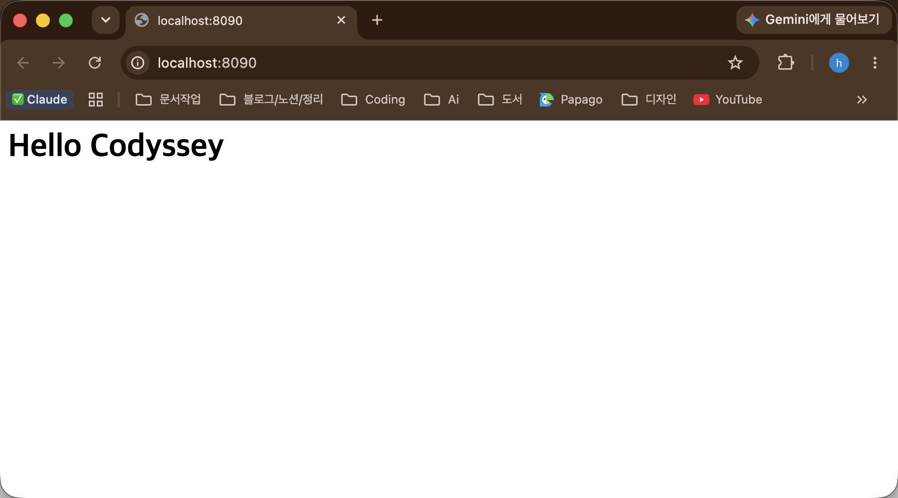
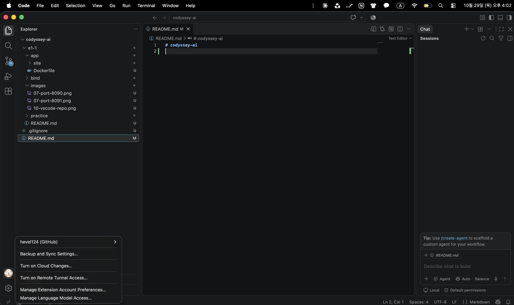
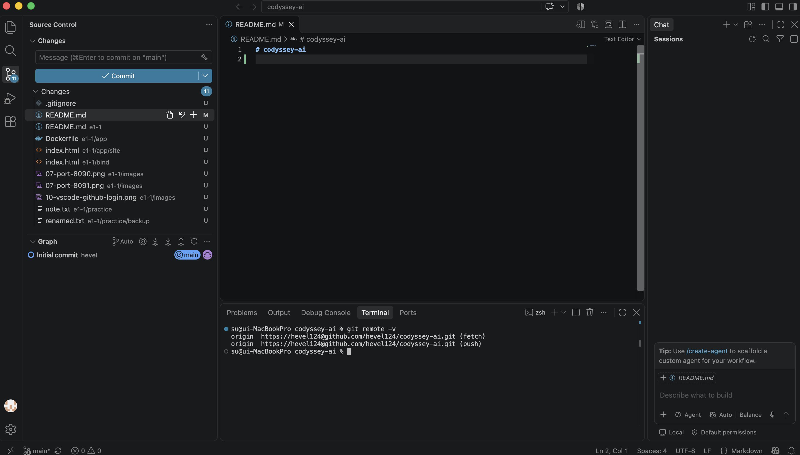

# 개발 워크스테이션 구축

## 1. 프로젝트 개요

코디세이 입학연수 미션 "내 컴퓨터에 개발자용 작업실 꾸미기" 수행 기록.

**목표**
- "내 컴퓨터에서만 돌아가는" 문제를 줄이고, 누가 몇 번 실행해도 같은 결과가 나오는 개발 환경 구성
- 이미지/컨테이너 분리, 격리된 실행 환경, 포트·스토리지 연결이 왜 필요한지 직접 실행 결과로 확인

**수행 범위**
- **터미널**: 파일·폴더 조작, 권한(r/w/x) 변경
- **Docker**: 설치 점검, 이미지·컨테이너 운영, Dockerfile 커스텀 웹 서버 이미지
- **연결 방식**: 포트 매핑(브라우저 접속), 바인드 마운트(호스트 변경 반영), 볼륨(데이터 유지)
- **Git/GitHub**: 사용자 정보·기본 브랜치 설정, VSCode GitHub 저장소 연동

모든 과정을 명령과 출력으로 남겨, 이 문서만 보고 같은 절차를 따라 할 수 있게 정리.

## 2. 실행 환경

| 항목 | 값 |
|---|---|
| OS | macOS 26.6.2 (Apple Silicon, arm64) |
| Shell | zsh 5.9 |
| Terminal | Orca 1.4.224 (6-8의 VSCode 화면만 VSCode 내장 터미널) |
| Docker | Docker Desktop, Docker version 29.9.2 |
| Git | git version 2.54.0 |

> ⚠️ 환경 주의
> - 출력에 보이는 `/Users/su/dev/code/codyssey-ai`는 작성자 PC 경로. 각자 저장소를 내려받은 위치로 바꿔 읽기.
> - 각 섹션은 저장소 루트(`codyssey-ai/`)에서 시작.

## 3. 수행 체크리스트

- [x] 터미널: 현재 위치·목록(숨김 파일 포함) 확인, 이동, 생성, 복사, 이동/이름 변경, 삭제, 파일 내용 확인, 빈 파일 생성
- [x] 권한: 파일 `note.txt` 644 → 600, 디렉토리 `backup/` 755 → 700 변경 전/후 비교
- [x] Docker: 버전·엔진 동작 점검, `nginx:alpine` 다운로드, 컨테이너 실행·중지·로그·리소스 확인, hello-world·ubuntu 실행, exec/attach 차이 관찰
- [x] Dockerfile: `nginx:alpine` 기반 커스텀 이미지 `e1-1-web:1.0` 빌드(내 페이지 복사, LABEL, HEALTHCHECK 추가)와 컨테이너 실행
- [x] 포트: `-p 8090:80`으로 실행 후 curl·브라우저 접속 확인
- [x] 마운트: `e1-1/bind/` 바인드 마운트 후 호스트 파일 수정 전/후 응답 비교
- [x] 볼륨: `e1-1-vol` 생성·연결, 컨테이너 삭제 전/후 데이터 유지 확인
- [x] Git: 저장소 사용자 정보·기본 브랜치 `main` 설정, `git config --list` 기록
- [x] GitHub: 원격 저장소 연결, VSCode GitHub 로그인·저장소 연동

## 4. 검증 방법

| 항목 | 확인 대상 | 검증 명령 | 확인한 내용 | 결과 위치 |
|---|---|---|---|---|
| 터미널 | 파일 생성·내용 | `cat note.txt` | `hello codyssey` 출력 | [6-1](#6-1-터미널-조작-로그) |
| 터미널 | 복사·이동·이름 변경 | `ls -la backup` | `renamed.txt`가 `backup/` 안에 있음 | [6-1](#6-1-터미널-조작-로그) |
| 터미널 | 삭제 | `ls -la` | `empty.txt`가 목록에서 사라짐 | [6-1](#6-1-터미널-조작-로그) |
| 권한 | 파일 권한 | `ls -l note.txt` | `rw-r--r--` → `rw-------` | [6-2](#6-2-권한-실습-및-증거-기록) |
| 권한 | 디렉토리 권한 | `ls -ld backup` | `rwxr-xr-x` → `rwx------` | [6-2](#6-2-권한-실습-및-증거-기록) |
| Docker | Docker 설치 | `docker --version` | 버전 29.9.2 출력 | [6-3](#6-3-docker-운영검증-로그) |
| Docker | Docker 엔진 동작 | `docker info` | `Server:` 정보 출력 (Server Version 29.9.2) | [6-3](#6-3-docker-운영검증-로그) |
| Docker | 이미지 다운로드 | `docker images` | `nginx:alpine` 목록에 표시 | [6-3](#6-3-docker-운영검증-로그) |
| Docker | 컨테이너 실행 | `docker ps` | `web-test`가 `Up` 상태 | [6-3](#6-3-docker-운영검증-로그) |
| Docker | 로그·리소스 | `docker logs`, `docker stats --no-stream` | nginx 시작 로그, CPU·메모리 사용량 출력 | [6-3](#6-3-docker-운영검증-로그) |
| Docker | 컨테이너 중지 | `docker ps -a` | `web-test`가 `Exited (0)` 상태 | [6-3](#6-3-docker-운영검증-로그) |
| Docker | hello-world | `docker run hello-world` | `Hello from Docker!` 출력 | [6-4](#6-4-컨테이너-실행-실습) |
| Docker | ubuntu 내부 명령 | `ls`, `echo` (컨테이너 안) | Linux 폴더 목록, `hello from container` 출력 | [6-4](#6-4-컨테이너-실행-실습) |
| Docker | exec 후 유지 | `docker ps` | exec에서 `exit` 후에도 `ubuntu-test`가 `Up` | [6-4](#6-4-컨테이너-실행-실습) |
| Docker | attach 후 종료 | `docker ps -a` | attach에서 `exit` 후 `ubuntu-test`가 `Exited (0)` | [6-4](#6-4-컨테이너-실행-실습) |
| Dockerfile | 커스텀 이미지 빌드 | `docker build`, `docker images` | `e1-1-web:1.0` 이미지 생성 | [6-5](#6-5-dockerfile-기반-웹-서버-컨테이너) |
| Dockerfile | 커스텀 이미지 실행 | `docker ps` | `e1-1-web`이 `Up (healthy)` 상태 | [6-5](#6-5-dockerfile-기반-웹-서버-컨테이너) |
| Dockerfile | 내 페이지 반영 | `docker exec e1-1-web cat .../index.html` | 컨테이너 안에 `Hello Codyssey` 페이지가 들어 있음 | [6-5](#6-5-dockerfile-기반-웹-서버-컨테이너) |
| 포트 | 포트 연결 | `docker ps --filter name=e1-1-web-8090` | `PORTS`에 `0.0.0.0:8090->80` 표시 | [6-6](#6-6-포트-매핑-접속-증거) |
| 포트 | 포트 접속 (터미널) | `curl -s http://localhost:8090` | `Hello Codyssey` 응답 | [6-6](#6-6-포트-매핑-접속-증거) |
| 포트 | 포트 접속 (브라우저) | 브라우저 `localhost:8090` | 주소창과 `Hello Codyssey` 화면 | [6-6](#6-6-포트-매핑-접속-증거) |
| 마운트 | 바인드 마운트 연결 | `docker inspect -f '{{range .Mounts}}...'` | `bind .../e1-1/bind -> /usr/share/nginx/html` | [6-7](#6-7-바인드-마운트-반영--볼륨-영속성-증거) |
| 마운트 | 호스트 변경 반영 | `curl -s http://localhost:8092` (수정 전/후) | `v1` → `v2 (edited on host)` | [6-7](#6-7-바인드-마운트-반영--볼륨-영속성-증거) |
| 볼륨 | 볼륨 생성 | `docker volume ls`, `docker volume inspect` | `e1-1-vol` 목록 표시, `Mountpoint` 출력 | [6-7](#6-7-바인드-마운트-반영--볼륨-영속성-증거) |
| 볼륨 | 컨테이너 삭제 후 볼륨 유지 | `docker ps -a`, `docker volume ls` | 컨테이너는 사라지고 `e1-1-vol`은 남음 | [6-7](#6-7-바인드-마운트-반영--볼륨-영속성-증거) |
| 볼륨 | 데이터 영속성 | `docker exec vol-reader cat /app-data/memo.txt` | 새 컨테이너에서 `saved before delete` 출력 | [6-7](#6-7-바인드-마운트-반영--볼륨-영속성-증거) |
| Git | 기본 브랜치 설정 | `git config --list` | `init.defaultbranch=main` | [6-8](#6-8-git-설정-및-githubvscode-연동-증거) |
| Git | 저장소 사용자 정보 | `git config user.name` | `hevel` | [6-8](#6-8-git-설정-및-githubvscode-연동-증거) |
| GitHub | 원격 저장소 연결 | `git remote -v` | `github.com/hevel124/codyssey-ai.git` | [6-8](#6-8-git-설정-및-githubvscode-연동-증거) |
| GitHub | VSCode GitHub 연동 | VSCode 계정 메뉴, 소스 제어 화면 | `hevel124 (GitHub)` 로그인, 원격 커밋 그래프 표시 | [6-8](#6-8-git-설정-및-githubvscode-연동-증거) |

## 5. 트러블슈팅

### 5-1. 호스트 포트 충돌로 컨테이너 실행 실패

> ⚠️ [6-5](#6-5-dockerfile-기반-웹-서버-컨테이너)·[6-6](#6-6-포트-매핑-접속-증거) 수행 후 진행.

**문제**: 8090 포트로 컨테이너를 하나 더 실행하자 에러 발생.
```bash
$ cd e1-1
$ docker run -d --name e1-1-web-dup -p 8090:80 e1-1-web:1.0
a986ade8953bfa907b6d771d6c14b5315b73c4d92cbe893f86112c133c74b226
docker: Error response from daemon: failed to set up container networking: driver failed programming external connectivity on endpoint e1-1-web-dup (45dbc613c41ba68909048ef199bd5feb68250b8f6ed293aea107e00bfead2895): Bind for 0.0.0.0:8090 failed: port is already allocated

Run 'docker run --help' for more information
```

**원인 가설**: [6-6](#6-6-포트-매핑-접속-증거)의 `e1-1-web-8090`이 내 컴퓨터의 8090 포트를 이미 사용 중.

**확인**: 8090을 쓰는 컨테이너 조회.
```bash
$ docker ps --filter publish=8090
CONTAINER ID   IMAGE          COMMAND                  CREATED             STATUS                       PORTS                                     NAMES
1450bf96762c   e1-1-web:1.0   "/docker-entrypoint.…"   About an hour ago   Up About an hour (healthy)   0.0.0.0:8090->80/tcp, [::]:8090->80/tcp   e1-1-web-8090
```

**해결**: 실패한 컨테이너를 지우고 비어 있는 8093 포트로 다시 실행.
```bash
$ docker rm -f e1-1-web-dup
e1-1-web-dup
$ docker run -d --name e1-1-web-dup -p 8093:80 e1-1-web:1.0
98f46f173c2401ba373872cf16c619122842ae27368a2d22a3a16cb3c4a580d2
$ curl -s http://localhost:8093
<h1>Hello Codyssey</h1>
```

### 5-2. Git 커밋 작성자가 다른 계정으로 설정됨

**문제**: 이 컴퓨터의 전역 Git 사용자 정보가 미션용 계정이 아닌 다른 계정. 그대로 커밋하면 작성자가 다른 계정으로 기록됨.

**원인 가설**: 예전에 `--global`로 설정한 다른 계정 정보가 이 저장소에도 적용됨.

**확인**: [6-8](#6-8-git-설정-및-githubvscode-연동-증거)의 `git config --list`에서 `user.name`이 두 번 나옴. 앞쪽은 전역 설정(다른 계정, 마스킹), 뒤쪽은 저장소 설정.

**해결**: 전역 설정은 다른 저장소에서 쓰므로 그대로 두고, 이 저장소에만 사용자 정보를 설정. `git config user.name` 결과가 `hevel`로 나오는 것을 6-8에서 확인.

## 6. 수행 로그

> 각 작업의 명령과 출력은 터미널에 나온 그대로 옮김. 단, 이미지 다운로드(`Pulling ...`)는 진행 표시가 같은 줄에 덮어써지므로 다운로드가 끝난 시점에 화면에 남은 내용을 기록.

### 6-1. 터미널 조작 로그

**이동, 현재 위치 확인**
```bash
$ cd e1-1
$ pwd
/Users/su/dev/code/codyssey-ai/e1-1
```

**폴더 생성, 이동**
```bash
$ mkdir practice
$ cd practice
```

**빈 파일 생성**
```bash
$ touch empty.txt
```

**파일 생성, 내용 확인**
```bash
$ echo "hello codyssey" > note.txt
$ cat note.txt
hello codyssey
```

**목록 확인 (숨김 파일 포함)**
```bash
$ ls -la
total 8
drwxr-xr-x  4 su  staff  128 10월 29 13:03 .
drwxr-xr-x@ 4 su  staff  128 10월 29 13:03 ..
-rw-r--r--  1 su  staff    0 10월 29 13:03 empty.txt
-rw-r--r--  1 su  staff   15 10월 29 13:03 note.txt
```

**복사**
```bash
$ cp note.txt note-copy.txt
```

**폴더 생성, 이동**
```bash
$ mkdir backup
$ mv note-copy.txt backup/
```

**이름 변경, 결과 확인**
```bash
$ mv backup/note-copy.txt backup/renamed.txt
$ ls -la backup
total 8
drwxr-xr-x  3 su  staff   96 10월 29 13:05 .
drwxr-xr-x  5 su  staff  160 10월 29 13:05 ..
-rw-r--r--  1 su  staff   15 10월 29 13:05 renamed.txt
```

**삭제, 결과 확인**
```bash
$ rm empty.txt
$ ls -la
total 8
drwxr-xr-x  4 su  staff  128 10월 29 13:05 .
drwxr-xr-x@ 4 su  staff  128 10월 29 13:03 ..
drwxr-xr-x  3 su  staff   96 10월 29 13:05 backup
-rw-r--r--  1 su  staff   15 10월 29 13:03 note.txt
```

### 6-2. 권한 실습 및 증거 기록

`practice/` 안의 파일 1개(`note.txt`)와 디렉토리 1개(`backup/`)의 권한을 바꾸고 전·후 비교.

**파일: 644 → 600**
```bash
$ cd e1-1/practice
$ ls -l note.txt
-rw-r--r--  1 su  staff  15 10월 29 13:03 note.txt
$ chmod 600 note.txt
$ ls -l note.txt
-rw-------  1 su  staff  15 10월 29 13:03 note.txt
```

**디렉토리: 755 → 700**
```bash
$ ls -ld backup
drwxr-xr-x  3 su  staff  96 10월 29 13:05 backup
$ chmod 700 backup
$ ls -ld backup
drwx------  3 su  staff  96 10월 29 13:05 backup
```

| 대상 | 변경 전 | 변경 후 |
|---|---|---|
| `note.txt` | `rw-r--r--` (644) | `rw-------` (600) |
| `backup/` | `rwxr-xr-x` (755) | `rwx------` (700) |

### 6-3. Docker 운영/검증 로그

#### 설치·점검

**버전 확인**
```bash
$ docker --version
Docker version 29.9.2, build a82e528
```

**엔진(데몬) 동작 확인**
```bash
$ docker info
Client:
 Version:    29.9.2
 Context:    desktop-linux
 Debug Mode: false
 Plugins:
  agent: Docker AI Agent Runner (Docker Inc.)
    Version:  v1.152.0
    Path:     /Users/su/.docker/cli-plugins/docker-agent
  ai: Docker AI Agent - Ask Gordon (Docker Inc.)
    Version:  v1.33.0
    Path:     /Users/su/.docker/cli-plugins/docker-ai
  buildx: Docker Buildx (Docker Inc.)
    Version:  v0.38.1
    Path:     /Users/su/.docker/cli-plugins/docker-buildx
  compose: Docker Compose (Docker Inc.)
    Version:  v5.6.1
    Path:     /Users/su/.docker/cli-plugins/docker-compose
  debug: Get a shell into any image or container (Docker Inc.)
    Version:  0.49.0
    Path:     /Users/su/.docker/cli-plugins/docker-debug
  desktop: Docker Desktop commands (Docker Inc.)
    Version:  4.97.0
    Path:     /Users/su/.docker/cli-plugins/docker-desktop
  dhi: CLI for managing Docker Hardened Images (Docker Inc.)
    Version:  v0.0.9
    Path:     /Users/su/.docker/cli-plugins/docker-dhi
  extension: Manages Docker extensions (Docker Inc.)
    Version:  v0.2.32
    Path:     /Users/su/.docker/cli-plugins/docker-extension
  init: Creates Docker-related starter files for your project (Docker Inc.)
    Version:  v1.4.1
    Path:     /Users/su/.docker/cli-plugins/docker-init
  mcp: Docker MCP Plugin (Docker Inc.)
    Version:  v0.44.2
    Path:     /Users/su/.docker/cli-plugins/docker-mcp
  model: Docker Model Runner (Docker Inc.)
    Version:  v1.2.9
    Path:     /Users/su/.docker/cli-plugins/docker-model
  offload: Docker Offload (Docker Inc.)
    Version:  v0.7.21
    Path:     /Users/su/.docker/cli-plugins/docker-offload
  pass: Docker Pass Secrets Manager Plugin (beta) (Docker Inc.)
    Version:  v0.3.2
    Path:     /Users/su/.docker/cli-plugins/docker-pass
  sandbox: "docker sandbox" is deprecated, use Docker Sandboxes instead (Docker Inc.)
    Version:  v0.13.0
    Path:     /Users/su/.docker/cli-plugins/docker-sandbox
  scout: Docker Scout (Docker Inc.)
    Version:  v1.27.0
    Path:     /Users/su/.docker/cli-plugins/docker-scout

Server:
 Containers: 0
  Running: 0
  Paused: 0
  Stopped: 0
 Images: 0
 Server Version: 29.9.2
 Storage Driver: overlayfs
  driver-type: io.containerd.snapshotter.v1
 Logging Driver: local
 Cgroup Driver: cgroupfs
 Cgroup Version: 2
 Plugins:
  Volume: local
  Network: bridge host ipvlan macvlan null overlay
  Log: awslogs fluentd gcplogs gelf journald json-file local splunk syslog
 CDI spec directories:
  /etc/cdi
  /var/run/cdi
 Discovered Devices:
  cdi: docker.com/gpu=webgpu
 Swarm: inactive
 Runtimes: io.containerd.runc.v2 runc
 Default Runtime: runc
 Init Binary: docker-init
 containerd version: b7a25261e029d68978bbf290df0a62fc819b3c51
 runc version: v1.5.2-0-g29dd3dc2
 init version: de40ad0
 Security Options:
  seccomp
   Profile: builtin
  cgroupns
 Kernel Version: 7.0.14-linuxkit
 Operating System: Docker Desktop
 OSType: linux
 Architecture: aarch64
 CPUs: 10
 Total Memory: 7.748GiB
 Name: docker-desktop
 ID: a4b6c963-f4d5-4894-a24d-9b49adb83e78
 Docker Root Dir: /var/lib/docker
 Debug Mode: false
 HTTP Proxy: http.docker.internal:3128
 HTTPS Proxy: http.docker.internal:3128
 No Proxy: hubproxy.docker.internal
 Labels:
  com.docker.desktop.address=unix:///Users/su/Library/Containers/com.docker.docker/Data/docker-cli.sock
 Experimental: false
 Insecure Registries:
  hubproxy.docker.internal:5555
  127.0.0.0/8
  ::1/128
 Live Restore Enabled: false
 Firewall Backend: iptables

```

`Server:` 아래 정보가 출력되므로 엔진 동작 중.

#### 운영 명령

**이미지 다운로드와 목록 확인**
```bash
$ docker pull nginx:alpine
alpine: Pulling from library/nginx

cbe54b031f3e: Pull complete
f523b340a6c0: Pull complete
d3531b7a4f21: Pull complete
1408044c7403: Pull complete
7b9d02243238: Pull complete
567a969e0221: Pull complete
dbb1ef19121a: Pull complete
c2fefbef5314: Pull complete
2d759c5f2f47: Download complete
db5a6d6bb46f: Download complete
Digest: sha256:785835ea65db4bba6f021acc0f3be91b0fef76a53fe41f8588c6698d2aed0606
Status: Downloaded newer image for nginx:alpine
docker.io/library/nginx:alpine
$ docker images
                                                                                                   i Info →   U  In Use
IMAGE          ID             DISK USAGE   CONTENT SIZE   EXTRA
nginx:alpine   785835ea65db       94.1MB         27.2MB
```

**컨테이너 실행과 목록 확인**
```bash
$ docker run -d --name web-test nginx:alpine
290448eac2ccf3a17819e1d2e758a55e64e15b5c3e014d09ae1b5b1138ff8c1d
$ docker ps
CONTAINER ID   IMAGE          COMMAND                   CREATED         STATUS         PORTS     NAMES
290448eac2cc   nginx:alpine   "/docker-entrypoint.…"   6 seconds ago   Up 5 seconds   80/tcp    web-test
```

**로그 확인**
```bash
$ docker logs web-test
/docker-entrypoint.sh: /docker-entrypoint.d/ is not empty, will attempt to perform configuration
/docker-entrypoint.sh: Looking for shell scripts in /docker-entrypoint.d/
/docker-entrypoint.sh: Launching /docker-entrypoint.d/10-listen-on-ipv6-by-default.sh
10-listen-on-ipv6-by-default.sh: info: Getting the checksum of /etc/nginx/conf.d/default.conf
10-listen-on-ipv6-by-default.sh: info: Enabled listen on IPv6 in /etc/nginx/conf.d/default.conf
/docker-entrypoint.sh: Sourcing /docker-entrypoint.d/15-local-resolvers.envsh
/docker-entrypoint.sh: Launching /docker-entrypoint.d/20-envsubst-on-templates.sh
/docker-entrypoint.sh: Launching /docker-entrypoint.d/30-tune-worker-processes.sh
/docker-entrypoint.sh: Configuration complete; ready for start up
2026/10/29 05:10:09 [notice] 1#1: using the "epoll" event method
2026/10/29 05:10:09 [notice] 1#1: nginx/1.31.8
2026/10/29 05:10:09 [notice] 1#1: built by gcc 15.2.0 (Alpine 15.2.0)
2026/10/29 05:10:09 [notice] 1#1: OS: Linux 7.0.14-linuxkit
2026/10/29 05:10:09 [notice] 1#1: getrlimit(RLIMIT_NOFILE): 1048576:1048576
2026/10/29 05:10:09 [notice] 1#1: start worker processes
2026/10/29 05:10:09 [notice] 1#1: start worker process 30
2026/10/29 05:10:09 [notice] 1#1: start worker process 31
2026/10/29 05:10:09 [notice] 1#1: start worker process 32
2026/10/29 05:10:09 [notice] 1#1: start worker process 33
2026/10/29 05:10:09 [notice] 1#1: start worker process 34
2026/10/29 05:10:09 [notice] 1#1: start worker process 35
2026/10/29 05:10:09 [notice] 1#1: start worker process 36
2026/10/29 05:10:09 [notice] 1#1: start worker process 37
2026/10/29 05:10:09 [notice] 1#1: start worker process 38
2026/10/29 05:10:09 [notice] 1#1: start worker process 39
```

**리소스 확인**
```bash
$ docker stats --no-stream
CONTAINER ID   NAME       CPU %     MEM USAGE / LIMIT     MEM %     NET I/O        BLOCK I/O    PIDS
290448eac2cc   web-test   0.00%     10.08MiB / 7.748GiB   0.13%     1.7kB / 126B   0B / 4.1kB   11
```

**중지 후 목록 비교**
```bash
$ docker stop web-test
web-test
$ docker ps
CONTAINER ID   IMAGE     COMMAND   CREATED   STATUS    PORTS     NAMES
$ docker ps -a
CONTAINER ID   IMAGE          COMMAND                   CREATED          STATUS                     PORTS     NAMES
290448eac2cc   nginx:alpine   "/docker-entrypoint.…"   42 seconds ago   Exited (0) 9 seconds ago             web-test
```

### 6-4. 컨테이너 실행 실습

**hello-world 실행**
```bash
$ docker run hello-world
Unable to find image 'hello-world:latest' locally
latest: Pulling from library/hello-world

58dee6a49ef1: Pull complete
c3bdf82c34d1: Download complete
Digest: sha256:c567b231f65614688711a75f31518a064258a51d442117a3e771a3a8fdba78ef
Status: Downloaded newer image for hello-world:latest

Hello from Docker!
This message shows that your installation appears to be working correctly.

To generate this message, Docker took the following steps:
 1. The Docker client contacted the Docker daemon.
 2. The Docker daemon pulled the "hello-world" image from the Docker Hub.
    (arm64v8)
 3. The Docker daemon created a new container from that image which runs the
    executable that produces the output you are currently reading.
 4. The Docker daemon streamed that output to the Docker client, which sent it
    to your terminal.

To try something more ambitious, you can run an Ubuntu container with:
 $ docker run -it ubuntu bash

Share images, automate workflows, and more with a free Docker ID:
 https://hub.docker.com/

For more examples and ideas, visit:
 https://docs.docker.com/get-started/

```

**ubuntu 컨테이너 진입 후 명령 실행**
```bash
$ docker run -it --name ubuntu-test ubuntu bash
Unable to find image 'ubuntu:latest' locally
latest: Pulling from library/ubuntu

6f01cc7d6fb3: Pull complete
afa7f7d582de: Pull complete
d597c14cfeb9: Download complete
Digest: sha256:6a06111c3b0a8600feadb270aec771dc239bf407b25625f93f44ab00e11f4d3c
Status: Downloaded newer image for ubuntu:latest
root@d09d7fa32107:/# #
root@d09d7fa32107:/# ls
bin  boot  dev  etc  home  lib  media  mnt  opt  proc  root  run  sbin  srv  sys  tmp  usr  var
root@d09d7fa32107:/# echo "hello from container"
hello from container
root@d09d7fa32107:/# exit
exit
$ docker ps -a
CONTAINER ID   IMAGE          COMMAND                   CREATED          STATUS                      PORTS     NAMES
d09d7fa32107   ubuntu         "bash"                    41 seconds ago   Exited (0) 5 seconds ago              ubuntu-test
14a153409f81   hello-world    "/hello"                  10 minutes ago   Exited (0) 10 minutes ago             infallible_mcclintock
290448eac2cc   nginx:alpine   "/docker-entrypoint.…"   12 minutes ago   Exited (0) 12 minutes ago             web-test
```

**exec로 진입 후 종료 → 컨테이너 유지**
```bash
$ docker start ubuntu-test
ubuntu-test
$ docker exec -it ubuntu-test bash
root@d09d7fa32107:/#
root@d09d7fa32107:/# exit
exit

What's next:
    Try Docker Debug for seamless, persistent debugging tools in any container or image → docker debug ubuntu-test
    Learn more at https://docs.docker.com/go/debug-cli/
$ docker ps
CONTAINER ID   IMAGE     COMMAND   CREATED         STATUS         PORTS     NAMES
d09d7fa32107   ubuntu    "bash"    4 minutes ago   Up 2 minutes             ubuntu-test
```

**attach로 진입 후 종료 → 컨테이너 종료**
```bash
$ docker attach ubuntu-test
root@d09d7fa32107:/#
root@d09d7fa32107:/# exit
exit
$ docker ps -a
CONTAINER ID   IMAGE          COMMAND                   CREATED          STATUS                      PORTS     NAMES
d09d7fa32107   ubuntu         "bash"                    5 minutes ago    Exited (0) 3 seconds ago              ubuntu-test
14a153409f81   hello-world    "/hello"                  14 minutes ago   Exited (0) 14 minutes ago             infallible_mcclintock
290448eac2cc   nginx:alpine   "/docker-entrypoint.…"   17 minutes ago   Exited (0) 16 minutes ago             web-test
```

**관찰 정리: exec와 attach의 차이**

| | `docker exec -it 컨테이너 bash` | `docker attach 컨테이너` |
|---|---|---|
| 동작 | 실행 중인 컨테이너 안에 **새 bash 프로세스**를 하나 더 띄워 접속 | 컨테이너의 **주 프로세스(처음 실행한 bash)**에 터미널을 연결 |
| `exit` 결과 | 새로 띄운 bash만 종료 → 컨테이너는 `Up` 유지 | 주 프로세스가 종료 → 컨테이너도 `Exited` |

컨테이너는 주 프로세스가 살아 있는 동안만 실행됨. 그래서 주 프로세스에 직접 붙는 attach에서 `exit`하면 컨테이너도 종료, 별도 프로세스로 들어가는 exec에서는 유지.

### 6-5. Dockerfile 기반 웹 서버 컨테이너

방식 (A) 선택. 웹 서버 베이스 이미지 `nginx:alpine`을 그대로 쓰고, 정적 페이지와 헬스체크만 추가. 소스는 [`app/`](app/) 폴더.

```
app/
├── Dockerfile
└── site/
    └── index.html
```

**작성한 파일**
```bash
$ cat e1-1/app/Dockerfile
FROM nginx:alpine
LABEL description="e1-1 custom nginx"
COPY site/ /usr/share/nginx/html/
HEALTHCHECK --interval=10s CMD wget -q -O /dev/null http://localhost/ || exit 1
$ cat e1-1/app/site/index.html
<h1>Hello Codyssey</h1>
```

**커스텀 포인트**

| 줄 | 하는 일 | 목적 |
|---|---|---|
| `FROM nginx:alpine` | 베이스 이미지 선택 | 검증된 웹 서버 위에서 시작 (alpine 기반이라 용량이 작음) |
| `LABEL description=...` | 이미지에 설명 메타데이터 추가 | 어떤 이미지인지 식별 |
| `COPY site/ /usr/share/nginx/html/` | 내 `site/` 폴더를 nginx가 보여 주는 폴더에 복사 | 기본 페이지를 내 페이지로 교체 |
| `HEALTHCHECK ... wget ...` | 10초마다 컨테이너 안에서 내 페이지에 접속해 응답을 검사 | 서버가 살아 있는지 Docker가 자동 확인 (`docker ps`에 `healthy` 표시) |

**빌드**

```bash
$ cd e1-1
$ docker build -t e1-1-web:1.0 app
#0 building with "desktop-linux" instance using docker driver

#1 [internal] load build definition from Dockerfile
#1 transferring dockerfile: 209B done
#1 DONE 0.0s

#2 [internal] load metadata for docker.io/library/nginx:alpine
#2 DONE 0.0s

#3 [internal] load .dockerignore
#3 transferring context: 2B done
#3 DONE 0.0s

#4 [internal] load build context
#4 transferring context: 93B done
#4 DONE 0.0s

#5 [1/2] FROM docker.io/library/nginx:alpine@sha256:785835ea65db4bba6f021acc0f3be91b0fef76a53fe41f8588c6698d2aed0606
#5 resolve docker.io/library/nginx:alpine@sha256:785835ea65db4bba6f021acc0f3be91b0fef76a53fe41f8588c6698d2aed0606 done
#5 DONE 0.0s

#6 [2/2] COPY site/ /usr/share/nginx/html/
#6 CACHED

#7 exporting to image
#7 exporting layers done
#7 exporting manifest sha256:6d366ef7293eef0b2b64f577f62032491214df9f7523f94695bd6d6d006fbbff done
#7 exporting config sha256:af3c360da45ef58292816f7ef624cf85ef34a4dc4bd620c40a573bac4800ed28 done
#7 exporting attestation manifest sha256:6f473b68b76bc38278c25c7d35cb2d2d4ff4c616b73b9d0fa7a4cb215e5f1847 done
#7 exporting manifest list sha256:3bb8ced3dc1e19d9e18403ec40201c9b99dc88c91853165c349e3607cee4ed74 done
#7 naming to docker.io/library/e1-1-web:1.0 done
#7 unpacking to docker.io/library/e1-1-web:1.0 done
#7 DONE 0.0s
$ docker images
IMAGE                ID             DISK USAGE   CONTENT SIZE   EXTRA
e1-1-web:1.0         3bb8ced3dc1e       93.2MB         26.3MB        
hello-world:latest   c567b231f656       22.6kB         10.3kB   U    
nginx:alpine         785835ea65db       94.1MB         27.2MB   U    
ubuntu:latest        6a06111c3b0a        181MB         44.9MB   U    
```

**실행과 확인**

```bash
$ docker run -d --name e1-1-web e1-1-web:1.0
23cf8103303b0df7f2cf7cd014fc313b9a62c076daaa01587b9905b5f6a5e471
$ docker ps
CONTAINER ID   IMAGE          COMMAND                  CREATED        STATUS                                     PORTS     NAMES
23cf8103303b   e1-1-web:1.0   "/docker-entrypoint.…"   1 second ago   Up Less than a second (health: starting)   80/tcp    e1-1-web
$ docker exec e1-1-web cat /usr/share/nginx/html/index.html
<h1>Hello Codyssey</h1>
```

**헬스체크 결과**

```bash
$ docker ps
CONTAINER ID   IMAGE          COMMAND                  CREATED          STATUS                    PORTS     NAMES
23cf8103303b   e1-1-web:1.0   "/docker-entrypoint.…"   23 seconds ago   Up 22 seconds (healthy)   80/tcp    e1-1-web
```

### 6-6. 포트 매핑 접속 증거

6-5에서 만든 `e1-1-web:1.0` 이미지를 `-p <내 컴퓨터 포트>:<컨테이너 포트>`로 실행.

**포트를 연결해 실행**
```bash
$ docker run -d --name e1-1-web-8090 -p 8090:80 e1-1-web:1.0
1450bf96762c1082915214a930aea6344f2d033e69b44352e86bd2ee7f7e0b8a
$ docker ps --filter name=e1-1-web-8090
CONTAINER ID   IMAGE          COMMAND                  CREATED          STATUS                    PORTS                                     NAMES
1450bf96762c   e1-1-web:1.0   "/docker-entrypoint.…"   13 seconds ago   Up 12 seconds (healthy)   0.0.0.0:8090->80/tcp, [::]:8090->80/tcp   e1-1-web-8090
```

**터미널 접속 확인**
```bash
$ curl -s http://localhost:8090
<h1>Hello Codyssey</h1>
```

**브라우저 접속 화면**



### 6-7. 바인드 마운트 반영 + 볼륨 영속성 증거

#### 바인드 마운트

내 컴퓨터의 폴더 `e1-1/bind/`를 컨테이너의 nginx 페이지 폴더(`/usr/share/nginx/html`)에 연결.

> ⚠️ `-v`의 호스트 쪽은 절대 경로여야 함. 그래서 `$(pwd)`(현재 폴더의 절대 경로)를 붙임. `e1-1/` 폴더에서 실행하면 각자 PC의 경로로 자동으로 바뀜.

**바인드 마운트 실행**
```bash
$ cd e1-1
$ echo "<h1>bind mount v1</h1>" > bind/index.html
$ docker run -d --name e1-1-bind -p 8092:80 -v "$(pwd)/bind:/usr/share/nginx/html" e1-1-web:1.0
8a5009960b99cc85bf3fc7d454c96ec3ce83736b112f68ae5462573d03d5f2bf
$ docker inspect -f '{{range .Mounts}}{{.Type}} {{.Source}} -> {{.Destination}}{{end}}' e1-1-bind
bind /Users/su/dev/code/codyssey-ai/e1-1/bind -> /usr/share/nginx/html
```

**변경 전**
```bash
$ curl -s http://localhost:8092
<h1>bind mount v1</h1>
```

**호스트에서 파일 수정 후**

컨테이너 재시작·이미지 재빌드 없이 호스트의 `bind/index.html`만 수정.
```bash
$ echo "<h1>bind mount v2 (edited on host)</h1>" > bind/index.html
$ curl -s http://localhost:8092
<h1>bind mount v2 (edited on host)</h1>
```

**관찰 정리: 변경 전/후 비교**

| 시점 | 호스트 `bind/index.html` | 컨테이너 응답 (`curl`) |
|---|---|---|
| 변경 전 | `bind mount v1` | `bind mount v1` |
| 호스트에서 수정 후 | `bind mount v2 (edited on host)` | `bind mount v2 (edited on host)` |

#### Docker 볼륨

`e1-1-vol` 볼륨 생성, 컨테이너 연결·파일 작성, 삭제 후 새 컨테이너에서 확인.

**볼륨 생성과 확인**
```bash
$ docker volume create e1-1-vol
e1-1-vol
$ docker volume ls
DRIVER    VOLUME NAME
local     e1-1-vol
$ docker volume inspect e1-1-vol
[
    {
        "CreatedAt": "2026-10-29T06:39:31Z",
        "Driver": "local",
        "Labels": null,
        "Mountpoint": "/var/lib/docker/volumes/e1-1-vol/_data",
        "Name": "e1-1-vol",
        "Options": null,
        "Scope": "local"
    }
]
```

**볼륨을 연결한 컨테이너 실행과 파일 쓰기 (삭제 전)**

```bash
$ docker run -d --name vol-writer -v e1-1-vol:/app-data ubuntu sleep infinity
9e87e690c7d8c0df86d9622f2a35c530a73f5f0559583b1f6a313ec77d0cb393
$ docker exec vol-writer sh -c 'echo "saved before delete" > /app-data/memo.txt'
$ docker exec vol-writer cat /app-data/memo.txt
saved before delete
```

**컨테이너 삭제**
```bash
$ docker rm -f vol-writer
vol-writer
$ docker ps -a
CONTAINER ID   IMAGE          COMMAND                   CREATED             STATUS                         PORTS                                     NAMES
8a5009960b99   e1-1-web:1.0   "/docker-entrypoint.…"   6 minutes ago       Up 6 minutes (healthy)         0.0.0.0:8092->80/tcp, [::]:8092->80/tcp   e1-1-bind
efd3f7831894   e1-1-web:1.0   "/docker-entrypoint.…"   22 minutes ago      Up 22 minutes (healthy)        0.0.0.0:8091->80/tcp, [::]:8091->80/tcp   e1-1-web-8091
c831409f2b76   e1-1-web:1.0   "/docker-entrypoint.…"   22 minutes ago      Up 22 minutes (healthy)        0.0.0.0:8090->80/tcp, [::]:8090->80/tcp   e1-1-web-8090
23cf8103303b   e1-1-web:1.0   "/docker-entrypoint.…"   24 minutes ago      Up 24 minutes (healthy)        80/tcp                                    e1-1-web
d09d7fa32107   ubuntu         "bash"                    About an hour ago   Exited (0) About an hour ago                                             ubuntu-test
14a153409f81   hello-world    "/hello"                  About an hour ago   Exited (0) About an hour ago                                             infallible_mcclintock
290448eac2cc   nginx:alpine   "/docker-entrypoint.…"   2 hours ago         Exited (0) 2 hours ago                                                   web-test
$ docker volume ls
DRIVER    VOLUME NAME
local     e1-1-vol
```
`docker ps -a` 목록에서 `vol-writer`가 사라졌지만, `docker volume ls`에는 `e1-1-vol`이 그대로 남음.

**새 컨테이너에 같은 볼륨 연결 후 확인 (삭제 후)**
```bash
$ docker run -d --name vol-reader -v e1-1-vol:/app-data ubuntu sleep infinity
7b418c3e965bdc9884a28c1bc3adf6fa2c37b8e682ccb1a64597bcca2bc685a8
$ docker exec vol-reader cat /app-data/memo.txt
saved before delete
```

**관찰 정리: 컨테이너 삭제 전/후 비교**

| 시점 | 컨테이너 | `e1-1-vol` 볼륨 | `/app-data/memo.txt` |
|---|---|---|---|
| 삭제 전 | `vol-writer` 실행 중 | 있음 | `saved before delete` |
| `vol-writer` 삭제 후 | 없음 | 있음 | (확인할 컨테이너 없음) |
| 새 컨테이너 연결 후 | `vol-reader` 실행 중 | 있음 | `saved before delete` |

### 6-8. Git 설정 및 GitHub/VSCode 연동 증거

> 🔒 이메일과 다른 계정 정보는 `********`로 마스킹.

**저장소 전용 사용자 정보 설정**
```bash
$ git config user.name "<본인 이름>"
$ git config user.email "<본인 이메일>"
```

**기본 브랜치 설정과 사용자 정보 확인**
```bash
$ git config --global init.defaultBranch main
$ git config user.name
hevel
$ git config user.email
********
```

**전체 설정 확인**
```bash
$ git config --list
credential.helper=osxkeychain
init.defaultbranch=main
user.email=********
user.name=********
core.quotepath=false
init.defaultbranch=main
core.repositoryformatversion=0
core.filemode=true
core.bare=false
core.logallrefupdates=true
core.ignorecase=true
core.precomposeunicode=true
remote.origin.url=https://hevel124@github.com/hevel124/codyssey-ai.git
remote.origin.fetch=+refs/heads/*:refs/remotes/origin/*
branch.main.remote=origin
branch.main.merge=refs/heads/main
user.name=hevel
user.email=********
```

**원격 저장소 연결 확인**
```bash
$ git remote -v
origin	https://hevel124@github.com/hevel124/codyssey-ai.git (fetch)
origin	https://hevel124@github.com/hevel124/codyssey-ai.git (push)
```

**VSCode GitHub 로그인과 저장소 연동**

VSCode 왼쪽 아래 계정 메뉴에 GitHub 계정 `hevel124`로 로그인된 상태.



VSCode에서 이 저장소를 연 화면. 소스 제어의 Graph에 원격 저장소의 첫 커밋(`Initial commit`, 작성자 `hevel`, 브랜치 `main`)이 보이고, VSCode 터미널의 `git remote -v`에 GitHub 원격 주소 출력.


